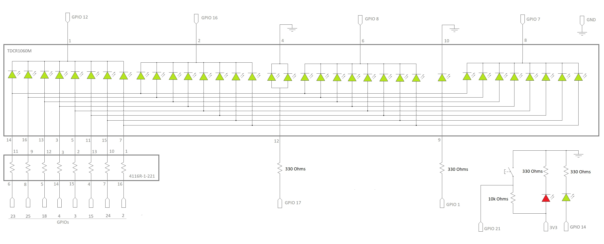

# Seven Segment

## Hardware Setup

### Part List

- 1 x TDCR1060M Clock Display
- 1 x 4116R-1-221-LF Resistor Array
- 4 x 330Ω Resistors
- 1 x 10kΩ Resistor
- 1 x Raspberry Pi
- 1 x Push button
- 2 x LEDs
- 1 x 40 pin Ribbon Cable-to-breadboard adapter
- 1 x 40 Pin Ribbon Cable

### Schematics



## Software

To run the program as a clock:

1. Change directory to this one (where README.md file is),
2. Execute:
```
python -m seven-segment clock
```
or to get the usage help information:
```
python -m seven-segment -h
```

### Timer mode

Counts down from a start time and shows the minutes and seconds, with the colon blinking. When it reaches '00:00', the LED blinks until the button is pressed.

'''
python -m seven-segment timer -t 01:30
python -m seven-segment timer --timestart 00:10

### Timer mode

The start time must be 'MM:SS' (minutes 0-99, seconds 00-59) and greater than '00:00'.

### Stopwatch mode
'''
python -m seven-segment stopwatch
'''

Each press-and-release of the button moves to the next state:

1. Start '000.0' seconds
2. After a press counts up, 100ms precision, blinking
3. After another press freezes on elapsed time continuously
4. After another press, reset to  '000.0' same as state 1

Press Crt+C to quit any mode.

